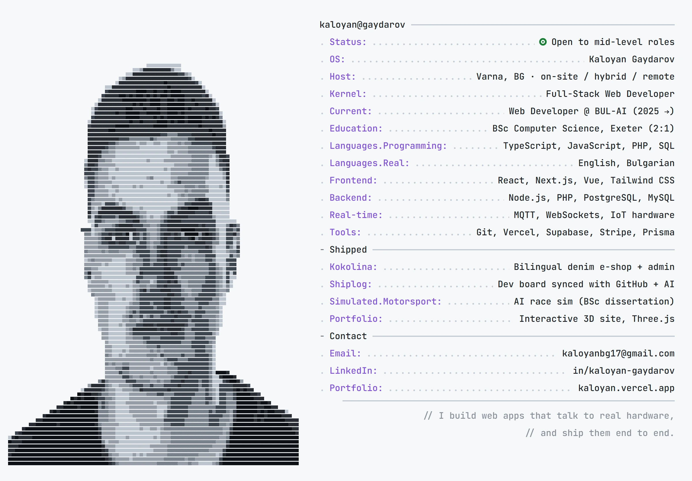

<a href="https://kaloyan.vercel.app">
  <picture>
    <source media="(prefers-color-scheme: dark)" srcset="https://raw.githubusercontent.com/KaloyanG17/KaloyanG17/main/dark_mode.webp">
    
  </picture>
</a>

## Hi, I'm Kaloyan 👋

Full-stack web developer in Varna, Bulgaria. At **BUL-AI** I build and maintain parking, access-control and security systems where web apps talk to real hardware: gates, cameras, licence-plate recognition, RFID readers and payment terminals, monitored in real time over **MQTT** and **WebSockets**. In my own time I ship full products end to end with **TypeScript, React and Next.js**.

**Open to mid-level web developer roles** · on-site, hybrid or remote

## Featured projects

| Project | What it shows | Stack | Links |
| --- | --- | --- | --- |
| **Kokolina** | Bilingual (BG/EN) e-commerce store with Stripe checkout, signed idempotent webhooks, stock per size, refunds, an admin dashboard and in-browser ML background removal for product photos | Next.js 15, TypeScript, Supabase, Stripe, Resend | [Live](https://kokolina.vercel.app) · [Code](https://github.com/KaloyanG17/kokolina) |
| **Shiplog** | Dev board kept in sync with GitHub through a GitHub App and HMAC-verified webhooks; PRs move cards, and an AI journal writes up each day | Next.js 16, React 19, Prisma, PostgreSQL, Gemini | [Live](https://shiplog-silk.vercel.app) · [Code](https://github.com/KaloyanG17/shiplog) |
| **Simulated Motorsport** | BSc dissertation: a 3D race where 20 AI cars steer themselves and a neural network decides pit stops and tyres | Three.js, YUKA, Brain.js | [Live](https://simulated-motorsport.vercel.app) · [Code](https://github.com/KaloyanG17/Simulated-Motorsport) |
| **3D Portfolio** | Interactive 3D site; cut the main model from 16 MB to 1.4 MB and lists projects live from the GitHub API | React, React Three Fiber, Tailwind CSS | [Live](https://kaloyan.vercel.app) · [Code](https://github.com/KaloyanG17/3d-website) |

## Experience

**Web Developer · BUL-AI | Bulgarian Artificial Intelligence** · Jan 2025 – present · Varna (hybrid)
- Build and maintain parking, access-control and security systems that connect web apps to gates, cameras, LPR, RFID and payment terminals
- Real-time IoT monitoring and control across sites with MQTT and WebSockets
- Android/Cordova intercom apps with video calling, auto-answer, door control and user roles
- Extend legacy PHP/MySQL systems with new features and integrations without breaking what already works

**BSc Computer Science · University of Exeter** · 2021 – 2024 · Upper Second-Class Honours (2:1)

## Tech

- **Languages:** TypeScript · JavaScript · PHP · SQL · Python
- **Frontend:** React · Next.js · Vue · Nuxt · Tailwind CSS · Three.js
- **Backend and data:** Node.js · PostgreSQL · MySQL · Prisma · Supabase · REST APIs
- **Real-time:** MQTT · WebSockets
- **Tooling:** Git · GitHub Actions · Vercel · Stripe · Vitest

## Contact

