<a href="https://kaloyan.vercel.app">
  <picture>
    <source media="(prefers-color-scheme: dark)" srcset="./banner-dark.svg">
    
  </picture>
</a>

  
  
  
  

  
  
  

## ⚡ In short

- 💼 **Web Developer at BUL-AI since January 2025.** I build the web side of parking, access-control and security systems.
- 🔌 **I connect software to physical devices:** gates, cameras, licence-plate recognition, RFID readers and payment terminals, monitored live over MQTT and WebSockets.
- 🚀 **I build and ship full products on my own:** database, payments, auth, deployment.
- 🎓 **BSc Computer Science, University of Exeter** (2:1, 2024).

## 💼 Experience

### Web Developer · BUL-AI (Bulgarian Artificial Intelligence)
*Jan 2025 – present · Varna, hybrid*

- Build and maintain parking, access-control and security systems that connect web apps to gates, cameras, LPR cameras, RFID readers and payment terminals
- Real-time monitoring and control of IoT devices across multiple sites with MQTT and WebSockets
- Android (Cordova) intercom apps with video calling, auto-answer, remote door control and user roles
- Add features and integrations to legacy PHP/MySQL systems that are in production, without breaking them

### BSc Computer Science · University of Exeter
*2021 – 2024 · Upper Second-Class Honours (2:1)*

Dissertation: [Simulated Motorsport](https://github.com/KaloyanG17/Simulated-Motorsport), an AI-driven 3D race simulation (see below).

## 🛠️ Projects

### 🛍️ Kokolina
**Online clothing store in Bulgarian and English, with real payments.**

- Stripe checkout with signed, idempotent webhooks, so a retried payment event never creates a duplicate order
- Stock tracked per size, refunds, and an admin dashboard
- Product-photo background removal that runs in the browser using an ML model

### 📋 Shiplog
**Project board that keeps itself up to date from GitHub.**

- GitHub App with HMAC-verified webhooks: issues become cards, and pull requests move them across the board
- An AI writes a daily dev journal from the day's activity

### 🏎️ Simulated Motorsport · BSc dissertation
**A 3D race where 20 AI cars drive themselves.**

- The cars steer themselves with steering behaviours
- A neural network makes the pit-stop and tyre decisions

### 🌐 3D Portfolio
**Interactive 3D personal site.**

- Cut the main 3D model from 16 MB to 1.4 MB so the site loads fast
- Project list is pulled live from the GitHub API

## 🧰 Tech

**Languages** 

**Frontend** 

**Backend & data** 

**Real-time & IoT** 

**Mobile & tools** 

